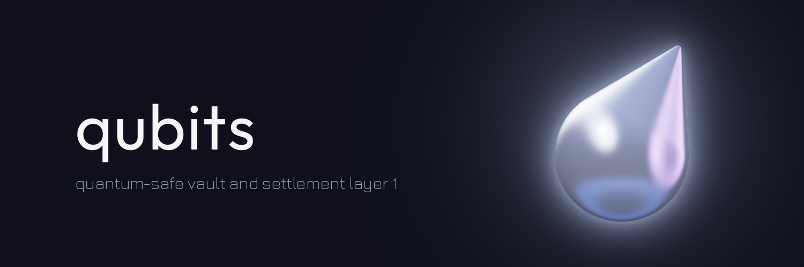

Qubits is a blockchain built to keep assets safe after quantum computers break the signatures most chains use today. This repository is its full node, command line wallet and smart contracts, written in Rust.

- **Post-quantum keys.** Accounts sign with the NIST standards: ML-DSA-65 (FIPS 204) by default, or SLH-DSA (FIPS 205) for keys kept offline. An account can also require M of N keys, mixing both.
- **Vaults.** An account can be made a vault: what it sends waits out a delay first, and a separate recovery key can cancel it and replace the owner key. A stolen key alone can't empty it.
- **Consensus.** Validators agree on blocks with Pipelined Moonshot, a BFT protocol: a block can be final after three network delays. They talk to each other over TLS 1.3 with a hybrid X25519 and ML-KEM key exchange.
- **Contracts.** Small WebAssembly programs, metered by gas. A token, an AMM and an escrow are included.

> Mainnet is not live, there is no public node yet, and the code has not had an independent audit. The [status page](https://qubits.sh/docs/status) lists what exists and what doesn't.

## What's in here

| Path | What it is |
|---|---|
| `crates/qubits-node` | The node: a validator, or an API node that follows one. Networking, HTTP and WebSocket API, sync, snapshots, history |
| `crates/qubits-cli` | The `qubits` command: keys, transfers, vaults, multisig, validator changes, contracts |
| `crates/qubits-consensus` | Pipelined Moonshot, as a state machine with no I/O, tested in simulated networks |
| `crates/qubits-execution` | The transaction rules: what makes a transaction valid and what it changes |
| `crates/qubits-vm` | The sandbox contracts run in |
| `crates/qubits-state` | Storage: a Merkle tree on RocksDB, so any balance can be proven against a block |
| `crates/qubits-types` | Addresses, accounts, transactions, blocks, and the JSON of the HTTP API |
| `crates/qubits-crypto` | The two signature schemes and password-encrypted key files |
| `crates/qubits-wasm` | The wallet core, compiled to WebAssembly for the browser extension |
| `crates/qubits-e2e` | End-to-end tests that run real processes over real connections |
| `contracts/` | The token, AMM and escrow contracts and the SDK they are written with. It has [its own guide](contracts/README.md) |

## Build and test

You need [Rust](https://rustup.rs) and a C++ compiler with clang, for RocksDB. `rust-toolchain.toml` pins the compiler version, so `rustup` installs the right one. The first build compiles RocksDB and takes a few minutes.

```sh
cargo build --workspace
cargo test --workspace --all-features
```

Dependencies are optimised even in debug builds, because SLH-DSA is too slow without it.

## Run a local chain

One validator on your machine, and a transfer on it. Each `key new` asks for a password.

```sh
cargo build --release -p qubits-node -p qubits-cli
export PATH="$PWD/target/release:$PATH"

mkdir ~/qubits-local && cd ~/qubits-local
qubits key new --out validator.json
qubits key new --out alice.json
qubits key new --out bob.json

VALIDATOR=$(qubits key show --key validator.json | awk '/public key/ {print $3}')
ALICE=$(qubits address --key alice.json)
BOB=$(qubits address --key bob.json)

cat > genesis.json <<JSON
{
  "chain_id": "local",
  "timestamp_ms": 1778112000000,
  "params": { "min_fee_per_byte": 10000000000, "max_block_transactions": 1000 },
  "validators": [{ "key": "$VALIDATOR", "payout": "$BOB" }],
  "accounts": [{ "address": "$ALICE", "balance": "1000000000000000000000" }]
}
JSON

qubits-node init --genesis genesis.json --data-dir data
qubits-node run --data-dir data --validator-key validator.json
```

The node asks for the validator's password and keeps running. Alice starts with 1,000 coins: amounts are in base units, with 18 decimals. To send 5 of them to Bob, open a second terminal in the repository and run:

```sh
export PATH="$PWD/target/release:$PATH"
cd ~/qubits-local
BOB=$(qubits address --key bob.json)
qubits transfer --key alice.json --to "$BOB" --amount 5000000000000000000 --wait
qubits account "$BOB"
```

The node's API is on `http://127.0.0.1:8545`. A chain with nothing to do makes no blocks, so the height only moves when transactions arrive. The [full walkthrough](https://qubits.sh/docs/quickstart) explains each step.

## Documentation

Everything else is at [qubits.sh/docs](https://qubits.sh/docs): the cryptography, accounts, vaults, consensus, contracts, running a node, the HTTP API and the CLI.

## License

Apache-2.0, see [`LICENSE`](LICENSE).
